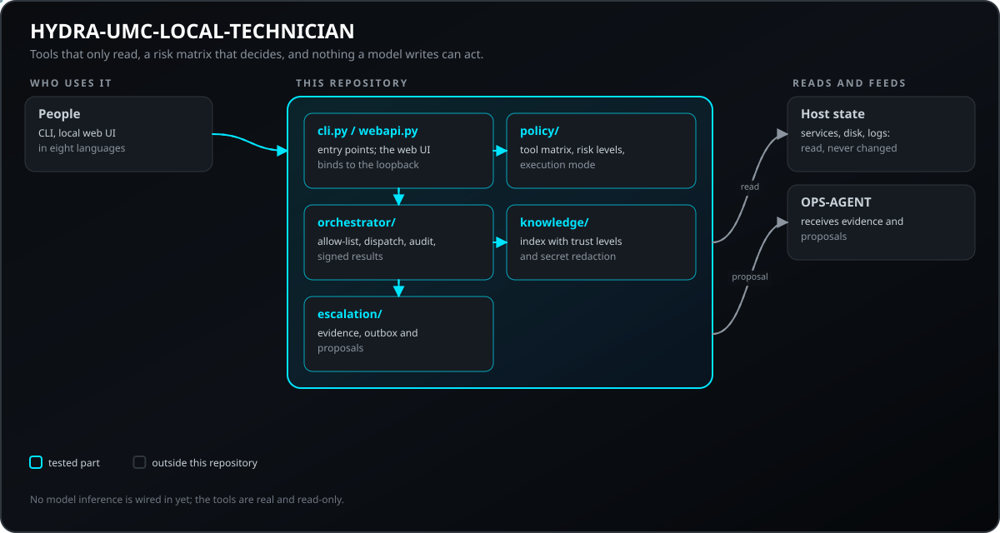
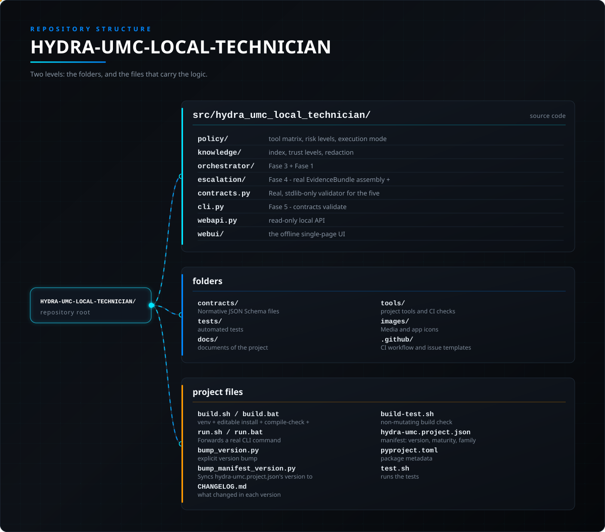

<!-- =============================================================================
HYDRA-UMC-LOCAL-TECHNICIAN - Local, policy-gated maintenance assistant
Copyright (C) JuanenRac (Electro Hobby 3D) <electrohobby3d@gmail.com>
GPL-3.0-or-later - see LICENSE
============================================================================= -->

<p align="center">
  
</p>

# 🤖 HYDRA-UMC-LOCAL-TECHNICIAN

<p align="center"><a href="README.md">🇺🇸 English</a> | <a href="README_spa.md">🇪🇸 Español</a> | <a href="README_fra.md">🇫🇷 Français</a> | <a href="README_ita.md">🇮🇹 Italiano</a> | <a href="README_deu.md">🇩🇪 Deutsch</a> | <a href="README_zho.md">🇨🇳 简体中文</a> | <a href="README_jpn.md">🇯🇵 日本語</a> | 🇵🇹 <b>Português</b></p>

### 🛡️ Técnico de manutenção com IA, local e regido por políticas

<p align="center">
  
  
  
  
  
  
  
</p>

---

**Verificação de honestidade - o que realmente funciona hoje:** a política de níveis de risco (`policy/risk_levels.py`), a lista de permissões fixa de ferramentas (`policy/tool_matrix.py`), os cinco validadores de contratos (`contracts.py` + `contracts/*.schema.json`), a fronteira de defesa contra injeção (`knowledge/trust.py`, `knowledge/redaction.py`), o índice local de conhecimento TF-IDF (`knowledge/index.py`, Fase 1), os 10 manipuladores de ferramentas de nível OBSERVE declarados (`orchestrator/dispatch.py` + `orchestrator/allowlist.py`: `service.status`, `storage.usage`, `network.port_status`, `network.connectivity`, `system.temperature`, `manifest.read`, `logs.read`, `process.list`, `update.pending`, `knowledge.search`), a construção real de `EvidenceBundle`/`MaintenanceProposal` (`escalation/evidence.py`, `escalation/proposal.py`, Fase 4) e uma CLI real sobre tudo isso (`tools list`/`tools call`/`escalation evidence`/`escalation propose`, a primeira fatia da Fase 5) são reais e estão testados (315 testes mais 149 subtestes a passar entre `tests/unit/` e `tests/adversarial/`) - as Fases 1, 3 e 4 estão concluídas, a Fase 5 está iniciada. O `update.pending` precisa da dependência opcional `hydra-umc-updater` (o extra `update-check`) para consultar de facto o GitHub e, sem ela, degrada com honestidade (`available: false`). Continua a não haver motor de inferência nem integração com o HYDRA-UMC-SERVER em lado nenhum deste repositório, e nada neste código pode ainda agir sobre uma `MaintenanceProposal` - a Fase 2 e o resto da Fase 5 (a API integrada no HYDRA-UMC-SERVER, e a voz) no Roteiro abaixo continuam inteiramente aspiracionais, sem qualquer código por trás. Veja o `CHANGELOG.md` para saber exatamente o que foi entregue até agora.

**Resultados assinados.** Um `ToolResult` nomeia agora a `tool` que o produziu e, quando há uma chave local configurada (`HYDRA_UMC_LOCAL_TECHNICIAN_RESULT_KEY`, ou `..._FILE` com um ficheiro, de 16 caracteres ou mais, fora do repositório), leva uma `signature`: HMAC-SHA256 sobre o JSON canónico de todo o resultado. Ao construir um pacote de evidências é recusado um resultado sem assinatura, forjado ou apresentado como de outra ferramenta; sem chave nada é assinado e nada é recusado, como antes. Os dois campos são opcionais no contrato, pelo que os resultados anteriores continuam válidos.

---

> **Estado de segurança (safety e security):** este ecossistema não é um sistema de segurança certificado. Ainda não existe um caminho de E-STOP por hardware, nem limites ou interlocks impostos pelo firmware, nem um comando de movimento verificado; as imagens de firmware são verificadas com CRC-32 e uma assinatura Ed25519, e uma compilação de versão recusa as chaves de desenvolvimento publicadas (as cabeças de ferramenta e as placas de expansão atrás do relé ainda usam os bootloaders do URTC, que aceitam um HMAC-SHA256 de chave partilhada em vez de uma assinatura); TLS e TLS mútuo são opcionais e estão desativados por defeito; nenhuma placa própria foi ainda montada ou testada. Leia a [base de segurança](https://github.com/JuanenRac/HYDRA-UMC-DOCS/blob/main/docs/SECURITY_BASELINE.md) e o [modelo de ameaças](https://github.com/JuanenRac/HYDRA-UMC-DOCS/blob/main/docs/THREAT_MODEL.md) antes de confiar em qualquer afirmação aqui para a segurança de uma pessoa.

---

## 📋 Num relance

| | |
|---|---|
| Versão | `0.1.7` |
| Maturidade | Funcional |
| Testes | 315 (`python -m pytest -q tests`) |
| Tecnologia | Python 3.11+ / JSON Schema / HailoRT GenAI (optional, later phase) / systemd (cm5 role, Linux only) |
| Destino | O Raspberry Pi CM5 de uma célula HYDRA-UMC |
| Em hardware real | Ainda não: não há registo de execução em hardware real para esta versão |

**Ir para:** [Visão geral](#-visão-geral) · [Arquitetura](#-arquitetura) · [Início rápido](#-início-rápido) · [Testes](#-testes) · [Estrutura do repositório](#-estrutura-do-repositório) · [Projetos relacionados](#-projetos-relacionados)

## 🚦 Estado do projeto

Cada linha é uma parte deste repositório e a luz diz até onde chega hoje. É escrita com o que o repositório consegue demonstrar (testes, compilações, execuções), não com o que está previsto.

🟢 Feito e verificado · 🟡 Funciona, com limites conhecidos · 🟠 Feito a meio ou ainda por verificar · 🔴 Por fazer ou a não funcionar

| Área | Estado | O que significa aqui |
|---|---|---|
| Software | 🟡 | Funciona para o seu propósito principal; a verificação de honestidade acima lista o que ainda falta |
| Testes | 🟢 | 315 testes automáticos, executados a cada alteração |
| Hardware real | 🔴 | Ainda não: não há registo de execução em hardware real para esta versão |
| Documentação | 🟢 | README em oito idiomas, verificado contra o manifesto a cada alteração |

## 🎯 Visão geral

O HYDRA-UMC-LOCAL-TECHNICIAN é uma IA local especializada no próprio ecossistema
HYDRA-UMC: observa, explica, diagnostica e propõe manutenção para os serviços
e nós do próprio ecossistema - nunca treina um novo modelo de base e nunca age
gerando texto. A sua plataforma de destino é o CM5, usando o acelerador
Hailo-10H quando estiver instalado, mas nada nesta entrega precisa dele ainda:
tudo até à Fase 3 é Python puro a ler estado real do anfitrião e a validar
dados puros - não há inferência de modelo em lado nenhum deste código por
enquanto.

**Princípio inegociável:** a IA nunca ganha autoridade por gerar uma resposta.
A política, as permissões e a confirmação humana decidem cada ação real - nunca
as palavras do próprio modelo.

Esta entrega traz oito peças reais e úteis por si mesmas:

1. **Política de níveis de risco** (`policy/risk_levels.py`) - seis níveis
   ordenados, de `INFORM` a `PHYSICAL_ACTION`, cada um com uma política real
   e testada (pode ler uma ferramenta, pode alterar, exige confirmação, está
   implementado). Os dois níveis mais altos estão declarados apenas para
   completar o contrato - genuinamente não implementados em lado nenhum
   deste código.
2. **Matriz de ferramentas** (`policy/tool_matrix.py`) - uma lista de
   permissões fixa de dez nomes reais de ferramentas de nível `OBSERVE`. Um
   nome de ferramenta ausente deste dicionário nunca pode ser chamado, ponto
   final - as 10 estão agora ligadas a um manipulador real (veja 5 e 6 abaixo).
3. **Contratos reais** (`contracts/*.schema.json` + `contracts.py`) -
   `ToolRequest`, `ToolResult`, `MaintenanceProposal`, `EvidenceBundle` e
   `PatchVerificationReport`, cada um com um ficheiro JSON Schema normativo e
   um validador Python correspondente, só com a biblioteca padrão, copiado
   dele campo a campo.
4. **Fronteira de defesa contra injeção** (`knowledge/trust.py` +
   `knowledge/redaction.py`) - o conteúdo não fiável (um README, uma linha de
   registo, uma mensagem de commit) é sempre embrulhado como `UntrustedText`,
   um tipo sem nenhum método capaz de produzir uma chamada de ferramenta. A
   única forma real de construir um `ToolRequest` recebe campos já tipados e
   já separados e recusa qualquer nome de ferramenta não registado ou não
   implementado antes de o objeto chegar a existir.
5. **Orquestrador de ferramentas** (`orchestrator/dispatch.py` +
   `orchestrator/allowlist.py`, Fase 3) - o `dispatch_tool_request()` executa
   de verdade um `ToolRequest` já validado e devolve um `ToolResult` real:
   `service.status` (um `systemctl is-active` real), `storage.usage`
   (`shutil.disk_usage`), `network.port_status` (uma sonda de socket real),
   `network.connectivity` (um HTTP GET real que reporta o código de estado
   real do próprio ponto de acesso - uma verificação genuinamente diferente
   da `network.port_status`, a mesma distinção real que o `inventory.py` do
   próprio HYDRA-UMC-OPS-AGENT faz entre uma ligação TCP simples e um GET de
   saúde real), `system.temperature` (o caminho sysfs real da zona térmica do
   Linux), `manifest.read` (uma leitura real de um `hydra-umc.project.json`),
   `logs.read` (uma cauda limitada e redigida de um ficheiro de registo da
   lista de permissões), `process.list` (uma correspondência real de
   substring em `/proc/<pid>/cmdline`, da lista de permissões) e
   `update.pending` (reutiliza a descoberta real do GitHub e a comparação de
   versões do próprio HYDRA-UMC-UPDATER, dependência opcional). Nenhuma delas
   aceita diretamente um caminho/anfitrião/porta/URL/nome de unidade/padrão
   em bruto - só um nome simbólico curto resolvido através de um
   `OrchestratorConfig` fixo, pelo que o texto de um documento envenenado
   nunca pode nomear um alvo real arbitrário, apenas um nome que já esteja na
   lista de permissões. O que um manipulador devolve é limitado e redigido na
   fronteira: a linha de comandos de um processo, um excerto de conhecimento e
   as linhas de registo de um pacote de evidências passam pela mesma redação de
   segredos do `logs.read`, o `manifest.read` devolve apenas quatro cadeias
   curtas e o `network.connectivity` reporta um redirecionamento em vez de o
   seguir.
6. **Índice de conhecimento recuperável** (`knowledge/index.py`, Fase 1) - um
   motor de pesquisa TF-IDF real e local (tokenize/build_index/search), portado
   sem alterações do `index.py` do próprio HYDRA-UMC-DOCS-QA, já testado, mais
   uma nova ingestão limitada de fontes Markdown (blocos delimitados por
   cabeçalho) e JSON (um ficheiro inteiro por bloco - um manifesto ou um
   esquema de contrato nunca se divide com utilidade a meio de um objeto).
   Ligado como a décima ferramenta, `knowledge.search`, através do novo
   `resolve_knowledge_source()` do `orchestrator/allowlist.py`: quem chama só
   nomeia uma fonte simbólica já presente na lista de permissões, nunca um
   caminho em bruto, e cada resultado real devolvido continua embrulhado como
   `UntrustedText` antes de sair do manipulador. A própria varredura é
   limitada (número de ficheiros, tamanho por ficheiro) mesmo para uma raiz
   legitimamente presente na lista de permissões - nunca às cegas, nunca o
   disco inteiro.
7. **Escalonamento: evidências e propostas** (`escalation/`, Fase 4) - o
   `evidence.assemble_evidence_bundle()` transforma um lote real de
   `ToolResult`s já executados e já validados num `EvidenceBundle` real,
   espelhando o `incident.py` do próprio HYDRA-UMC-OPS-AGENT: derivação pura
   de dados já observados, nunca uma chamada a uma IA.
   O `proposal.propose_maintenance()` é um construtor/validador real de
   `MaintenanceProposal` - deliberadamente NÃO um gerador, já que ainda não
   existe motor de inferência e o princípio inegociável deste projeto proíbe
   fabricar um diagnóstico. Hoje só um operador humano fornece
   `diagnosis`/`steps`/`rollback`; a única salvaguarda real que este módulo
   acrescenta é que cada entrada de `citedEvidence` tem de coincidir
   literalmente com o campo `evidence` de um resultado de ferramenta real já
   observado, ou a proposta é recusada sem mais. O `confirmationRequired`
   nunca é definível por quem chama - é sempre exatamente o que a política de
   `policy/risk_levels.py` já diz para o risco declarado da proposta. Nada
   neste código pode ainda agir sobre uma `MaintenanceProposal`.
8. **Superfície de CLI** (`cli.py`, a primeira fatia real da Fase 5) - `tools
   list`/`tools call` e `escalation evidence`/`escalation propose` dão pela
   primeira vez a cada peça acima uma linha de comandos real (até agora todas
   só eram alcançáveis a partir de um teste). Não acrescenta autoridade
   própria: o `tools call` constrói um `ToolRequest` através do mesmo
   `build_tool_request_from_model_output()` que todos os testes já chamam e
   executa-o pelo mesmo `dispatch_tool_request()` - continua a ser só uma
   ferramenta de nível OBSERVE, já que nada acima de OBSERVE está
   implementado em lado nenhum deste código. O `--config` carrega um
   `OrchestratorConfig` real a partir de um ficheiro JSON (ou recorre ao
   `default_config()`); continua a não haver forma de nomear um
   caminho/anfitrião/porta em bruto na própria linha de comandos.

```
$ hydra-umc-local-technician contracts validate tests/fixtures/tool_request.valid.json --contract ToolRequest
VALID: tests/fixtures/tool_request.valid.json (ToolRequest)

$ hydra-umc-local-technician contracts validate tests/fixtures/tool_request.invalid.json --contract ToolRequest
INVALID: tests/fixtures/tool_request.invalid.json (ToolRequest): ...
```

Não há invocação por omissão nem interface gráfica nesta entrega - veja
[docs/CLI_REFERENCE.md](docs/CLI_REFERENCE.md) para a superfície real e
completa de comandos.

## 🧩 Papel no HYDRA-UMC

O **HYDRA-UMC-LOCAL-TECHNICIAN** é o assistente de manutenção local do ecossistema: observa, explica e propõe, e o texto de um modelo nunca é autoridade para agir. As suas ferramentas são permitidas e só de leitura, e o que encontra é entregue a pessoas ou ao `HYDRA-UMC-OPS-AGENT` como provas e propostas.

## 🏛️ Arquitetura

<p align="center">
  
</p>

### ARQUITETURA E DECISÕES DE DESENHO

- **A IA nunca ganha autoridade por gerar uma resposta.** Cada decisão de
  desenho desta entrega existe para proteger este único princípio - veja
  [docs/SECURITY_MODEL.md](docs/SECURITY_MODEL.md) para o modelo completo.
- **Uma ferramenta tem de estar registada antes de poder ser chamada.** O
  `TOOL_MATRIX` do `policy/tool_matrix.py` é a lista completa e fixa; o
  `lookup_tool()` devolver `None` é uma recusa incondicional, nunca um caso
  para adivinhar um nível de risco por omissão.
- **O conteúdo não fiável nunca pode tornar-se um comando.** A defesa é
  arquitetural (um tipo sem nenhum método que produza ferramentas), não um
  filtro que tenta reconhecer texto «com ar de instrução» - um jogo perdido
  contra uma injeção de prompt determinada. Veja
  `tests/adversarial/test_injection_defense.py`, o critério de saída literal
  da própria Fase 0.
- **A fonte normativa de um contrato é o seu ficheiro JSON Schema.** As
  listas de campos e os validadores do `contracts.py` são copiados de
  `contracts/*.schema.json`, campo a campo, seguindo a convenção do
  `validation.py` do próprio HYDRA-UMC-SDK - não uma segunda fonte de verdade
  independente.
- **A redação de segredos é uma cópia partilhada.** `knowledge/redaction.py` é a redação mantida pelo HYDRA-UMC-SDK (`tools/canonical/redaction.py`), idêntica à do agente de operações e verificada com os mesmos casos comuns (`tests/redaction_vectors.json`).
- **Cada pedido de ferramenta pode ser auditado.** Com `--audit-log CAMINHO` (ou `HYDRA_UMC_LOCAL_TECHNICIAN_AUDIT_LOG`, ou `auditLog` no ficheiro de configuração) cada pedido é escrito num diário JSONL só de acrescentar antes de correr e o seu resultado depois, redigido, cada linha encadeada à anterior pelo seu SHA-256 e rodada por tamanho. Um pedido que não possa ser registado não é executado; `audit-verify CAMINHO` verifica a cadeia. Desativado por predefinição.
- **`PRIVILEGED_CHANGE` e `PHYSICAL_ACTION` continuam por implementar.** Uma
  barreira deliberada e permanente até existirem um desenho dedicado, um
  caminho de autorização separado e, no caso da ação física, bloqueios reais -
  não um descuido a completar mais tarde.
- **A recuperação de conhecimento é limitada e de lista de permissões, nunca
  às cegas.** O `knowledge.search` só indexa uma raiz já presente na lista de
  permissões (o `resolve_knowledge_source` do `orchestrator/allowlist.py`), e
  a própria varredura é limitada por um teto real de número de ficheiros e de
  tamanho por ficheiro - «nunca treinado às cegas sobre o disco inteiro»
  mantém-se mesmo para uma raiz que um operador já decidiu ser segura.
- **Esta entrega apenas declara, recupera e valida - não age.** Não há motor
  de inferência, nem execução real de ferramentas acima de OBSERVE, nem
  integração com o HYDRA-UMC-SERVER em lado nenhum deste repositório por
  enquanto.

## 🚀 Início rápido

Requer Python 3.11 ou superior.

```bash
./build.sh  # Linux, macOS (build.bat on Windows)
./run.sh contracts validate tests/fixtures/tool_request.valid.json --contract ToolRequest
./run.sh --version
```

## 🧪 Testes

315 testes automáticos correm com `python -m pytest -q tests`. Não precisam de hardware nem de nada fora desta máquina.

A CI executa `HYDRA_UMC_CI=1 python tools/ci_validate.py`, que verifica o manifesto, os documentos, os oito README e as imagens.

## 🏗️ Compilação e publicação

```bash
chmod +x build.sh   # uma só vez
./build.sh          # cria o .venv, pip install -e ".[dev]", verificação de compilação + testes
./run.sh contracts validate tests/fixtures/tool_request.valid.json --contract ToolRequest
./run.sh --version
```

No Windows: `build.bat` e depois `run.bat contracts validate ...` /
`run.bat --version`. O `build-test.sh`/`.bat` faz a mesma verificação
não alteradora de sintaxe Python que o fluxo de CI deste projeto faz, sem
tocar na versão do projeto nem no CHANGELOG - NÃO executa a suite de testes
em si; execute `./build.sh`/`build.bat` (ou `pytest tests/` diretamente) para
a suite de testes local completa.

**Resolução de problemas**

- O `contracts validate` termina com `1` e `INVALID: ...`: leia a mensagem -
  nomeia o campo exato e o motivo, não apenas que algo falhou. Consulte
  [docs/CONTRACTS.md](docs/CONTRACTS.md) para a forma real e esperada de cada
  um dos cinco contratos.
- Um teste em `tests/adversarial/` falha: este é o critério de saída literal
  da própria Fase 0 - trate qualquer falha aí como uma regressão real na
  fronteira de defesa contra injeção, nunca como um teste a relaxar.

## 📂 Estrutura do repositório

<p align="center">
  
</p>

<details>
<summary>Versão em texto da árvore</summary>

```text
HYDRA-UMC-LOCAL-TECHNICIAN/
├── src/hydra_umc_local_technician/   código-fonte
│   ├── policy/                       matriz de ferramentas, níveis de risco, modo de execução
│   ├── knowledge/                    índice, níveis de confiança, ocultação
│   ├── orchestrator/                 Fase 3 + Fase 1 - os 10 manipuladores reais de ferramentas de nível OBSERVE, completos
│   ├── escalation/                   Fase 4 - montagem real de EvidenceBundle + construção de MaintenanceProposal, completas
│   ├── contracts.py                  Validador real, só com a biblioteca padrão, para os cinco contratos mínimos
│   ├── cli.py                        Fase 5 - contracts validate, tools list/call, escalation evidence/propose, --version, serve
│   ├── webapi.py                     API local só de leitura: apenas GET, loopback por omissão, token fora do loopback, ocultada e limitada
│   └── webui/                        a interface offline de página única: index.html, app.js, app.css e i18n/ em oito idiomas
├── contracts/                        Ficheiros JSON Schema normativos (draft 2020-12) dos cinco contratos
├── tests/                            testes automáticos
├── docs/                             documentos do projeto
├── tools/                            ferramentas do projeto e verificações da CI
├── images/                           Multimédia e ícones da aplicação
├── .github/                          fluxo de CI e modelos de problemas
├── build.sh / build.bat              venv + instalação editável + verificação de compilação + testes
├── run.sh / run.bat                  Reencaminha um comando real da CLI
├── bump_version.py                   Subida de versão ao estilo conta-quilómetros (executada só pelo comando `bump` explícito)
├── bump_manifest_version.py          Sincroniza a versão do hydra-umc.project.json com a nativa (--sync)
├── CHANGELOG.md                      o que mudou em cada versão
├── build-test.sh                     verificação de compilação sem alterações
├── hydra-umc.project.json            manifesto: versão, maturidade, família
├── pyproject.toml                    metadados do pacote
└── test.sh                           executa os testes
```

</details>

## 🗺️ Roteiro e limites conhecidos

**Limites conhecidos hoje**

Esta versão traz a Fase 0, a Fase 1, a Fase 3 e a Fase 4. O que falta, por ordem de fases:

- **Fase 1 - Conhecimento recuperável (concluída).** Um índice local e versionado
  de documentação, manifestos, contratos e guias de procedimentos aprovados -
  nunca treinado às cegas sobre o disco inteiro. O `knowledge/index.py` porta
  sem alterações a pesquisa TF-IDF, já testada, do próprio HYDRA-UMC-DOCS-QA e
  acrescenta uma ingestão limitada, da lista de permissões, para fontes
  Markdown e JSON, ligada como a décima ferramenta de nível OBSERVE,
  `knowledge.search`.
- **Fase 2 - Motor de inferência local.** Um LLM pequeno compatível com o
  Hailo-10H (candidatos: Qwen2.5-1.5B-Instruct, Qwen2.5-Coder-1.5B,
  Qwen3-1.7B-Instruct), escolhido só depois de verificadas a compatibilidade
  real com o Hailo, a latência, a qualidade de idiomas, o consumo de energia e
  a licença.
- **Fase 3 - Orquestrador de ferramentas (concluída: 9 de 9 ferramentas
  declaradas).** Código determinístico que liga cada manipulador real de
  ferramenta de nível `OBSERVE` ao `TOOL_MATRIX`, com aplicação da política em
  cada chamada. `service.status`, `storage.usage`, `network.port_status`,
  `network.connectivity`, `system.temperature`, `manifest.read`, `logs.read`,
  `process.list` e `update.pending` são agora todos reais
  (`orchestrator/dispatch.py`).
- **Fase 4 - Propostas e evidências (concluída).** Construção real de
  `MaintenanceProposal` e `EvidenceBundle` (`escalation/`), a escalar para o
  futuro papel de Nó de Desenvolvimento do próprio HYDRA-UMC-DEV-SERVER. O
  `evidence.assemble_evidence_bundle()` deriva um pacote real a partir de
  `ToolResult`s já observados; o `proposal.propose_maintenance()` valida e
  fundamenta uma proposta fornecida por uma pessoa contra evidências reais -
  nunca gera uma, já que ainda não existe motor de inferência. Nada neste
  código pode ainda agir sobre uma `MaintenanceProposal`.
- **Fase 5 - Interface de utilizador (iniciada: a fatia da CLI).** Uma API
  local integrada no HYDRA-UMC-SERVER/Studio, depois uma CLI, depois voz -
  nunca contornando as fronteiras de política e confirmação que a Fase 0 já
  estabelece. A fatia da CLI é real agora: `tools list`/`tools call` e
  `escalation evidence`/`escalation propose` (`cli.py`) chegam a todas as
  peças reais acima pelo mesmo caminho de código, já testado e já regido por
  políticas, deliberadamente limitado ao que vive dentro deste único
  repositório. A API integrada no HYDRA-UMC-SERVER e a voz continuam a ser
  trabalho separado, entre repositórios, para uma entrega posterior.

- **Fase 5 - API local só de leitura e página web (segunda parte).** `serve` (`webapi.py`, `webui/`) mostra o que o técnico já produziu: o registo de ferramentas, os ficheiros ToolResult, EvidenceBundle e MaintenanceProposal de uma pasta de dados, os manifestos dos projetos e o índice de documentos das fontes de conhecimento permitidas. Só responde a GET (qualquer outro método recebe 405), escuta em `127.0.0.1` salvo indicação em contrário e então exige um token bearer de pelo menos 24 carateres, encontra os itens listando as suas pastas (nunca juntando um caminho do pedido), oculta cada resposta como a CLI faz e limita todos os tamanhos. A página única não precisa de nada da internet e está disponível em inglês, espanhol, alemão, francês, italiano, japonês, chinês e português de Portugal. Veja [docs/WEB_API.md](docs/WEB_API.md).

A Fase 2 e o resto da Fase 5 ainda não existem neste repositório -
veja [docs/ARCHITECTURE.md](docs/ARCHITECTURE.md) para o que cada fase restante
inclui e exclui explicitamente, e
[docs/SECURITY_MODEL.md](docs/SECURITY_MODEL.md) para as invariantes de
segurança que cada fase tem de continuar a respeitar.

## 🌍 Idiomas

Este README e os documentos do repositório existem em oito idiomas: inglês, espanhol, alemão, francês, italiano, japonês, chinês e português (Portugal). São escritos em conjunto e a CI verifica que os oito ficheiros têm as mesmas secções e as mesmas ligações. Este repositório não tem ecrã nem catálogo de mensagens próprios, por isso não há textos de interface para traduzir.

## 🔗 Projetos relacionados

Este projeto faz parte do ecossistema de robótica HYDRA-UMC do mesmo autor (JuanenRac / Electro Hobby 3D). Vale a pena conhecê-los, porque um pedido pode ser, na verdade, sobre um destes e não sobre este repositório.

**Diretamente relacionados**
- **[HYDRA-UMC-COGNITIVE-NODE](https://github.com/JuanenRac/HYDRA-UMC-COGNITIVE-NODE)** — o projeto-mãe deste: o centro de integração do pipeline cognitivo Hailo-10 em que correrá o futuro motor de inferência deste técnico.
- **[HYDRA-UMC-OPS-AGENT](https://github.com/JuanenRac/HYDRA-UMC-OPS-AGENT)** — é dono do ciclo de vida dos incidentes de manutenção (evidências, diagnóstico, alteração aprovada por uma pessoa, implementação canário, verificação); o `knowledge/redaction.py` deste técnico é uma portagem direta do seu `log_redaction.py`, já testado, e uma fase futura escala pacotes de evidências reais para ele, sem nunca contornar o seu próprio fluxo de aprovação.
- **[HYDRA-UMC-DEV-SERVER](https://github.com/JuanenRac/HYDRA-UMC-DEV-SERVER)** — o futuro Nó de Desenvolvimento a que uma fase posterior envia um `EvidenceBundle` real para estudo, teste e um patch revisto - nunca um canal de patches direto e automático.
- **[HYDRA-UMC-SDK](https://github.com/JuanenRac/HYDRA-UMC-SDK)** — definirá os contratos partilhados e versionados com que os `contracts/*.schema.json` locais deste projeto deverão ser reconciliados, quando também existirem lá.
- **[HYDRA-UMC-SERVER](https://github.com/JuanenRac/HYDRA-UMC-SERVER)** — o futuro ponto de entrada autenticado que alojará o endpoint, as sessões, os papéis e o registo de auditoria deste técnico.

**Também fazem parte do ecossistema**

*Hardware e plataforma centrais*
- **[HYDRA-UMC](https://github.com/JuanenRac/HYDRA-UMC)** — o desenho da placa-mãe do braço robótico: anfitrião CM5 + STM32H745 de dois núcleos, pensado para orquestrar até 8 braços de ferramenta por CAN-OTA/SPI-OTA (firmware numa fase inicial; ainda sem placa montada).
- **[HYDRA-UMC-OS](https://github.com/JuanenRac/HYDRA-UMC-OS)** — camada de produto reproduzível do Raspberry Pi OS para o CM5: agente só de leitura, configuração/perfis validados, aprovisionamento Wi-Fi de primeiro contacto.

*Backend central e clientes*
- **[HYDRA-UMC-STUDIO](https://github.com/JuanenRac/HYDRA-UMC-STUDIO)** — painel web de controlo com visualização 3D em tempo real de vários robôs.
- **[HYDRA-UMC-SUITE](https://github.com/JuanenRac/HYDRA-UMC-SUITE)** — centro de comando de enxame para desktop (PySide6) para vários servidores ao mesmo tempo.
- **[HYDRA-UMC-ANDROID-CONTROL](https://github.com/JuanenRac/HYDRA-UMC-ANDROID-CONTROL)** — aplicação Android nativa de controlo, com início de sessão biométrico e um companheiro Wear OS emparelhado.
- **[HYDRA-UMC-IOS-CONTROL](https://github.com/JuanenRac/HYDRA-UMC-IOS-CONTROL)** — aplicação de controlo para iOS/iPadOS (Flutter) com sincronização WebSocket em tempo real.
- **[HYDRA-UMC-DSI](https://github.com/JuanenRac/HYDRA-UMC-DSI)** — interface tátil nativa para o ecrã tátil DSI de 7" integrado, executada no próprio CM5.
- **[HYDRA-UMC-EDITOR-URDF](https://github.com/JuanenRac/HYDRA-UMC-EDITOR-URDF)** — criador/editor gráfico de URDF para desktop que envia os modelos concluídos para o catálogo do STUDIO.
- **[HYDRA-UMC-EDITOR-STL](https://github.com/JuanenRac/HYDRA-UMC-EDITOR-STL)** — editor de modelos STL para desktop que transforma/substitui/remove/adiciona peças reais no mesmo catálogo de modelos que o HYDRA-UMC-EDITOR-URDF também edita.
- **[HYDRA-UMC-BRIDGE-AMR](https://github.com/JuanenRac/HYDRA-UMC-BRIDGE-AMR)** — fronteira de coordenação para frotas AGV/AMR através de um publicador MQTT VDA 5050 (testado apenas contra uma frota emulada).
- **[HYDRA-UMC-BRIDGE-CNC](https://github.com/JuanenRac/HYDRA-UMC-BRIDGE-CNC)** — coordenador de células CNC de alto nível com acesso ao estado GRBL e aos bytes de controlo (testado apenas contra um emulador).
- **[HYDRA-UMC-BRIDGE-DROIDS](https://github.com/JuanenRac/HYDRA-UMC-BRIDGE-DROIDS)** — fronteira de coordenação para droides com patas/humanoides, com um emissor de comandos para o Boston Dynamics Spot (testado apenas contra um emulador).
- **[HYDRA-UMC-BRIDGE-LASER](https://github.com/JuanenRac/HYDRA-UMC-BRIDGE-LASER)** — coordenador de células laser que lê 3 sinais GPIO (chave, caixa e interlock) (testado apenas contra um chip simulado; não pode armar nem disparar um laser).
- **[HYDRA-UMC-BRIDGE-OPENPNP](https://github.com/JuanenRac/HYDRA-UMC-BRIDGE-OPENPNP)** — coordenador seguro de fluxo de placa de alto nível para pick-and-place com OpenPnP.
- **[HYDRA-UMC-BRIDGE-PRINTER3D](https://github.com/JuanenRac/HYDRA-UMC-BRIDGE-PRINTER3D)** — fronteira de coordenação segura para impressoras 3D Moonraker/Klipper, com comandos de trabalho reais protegidos por portas.
- **[HYDRA-UMC-BRIDGE-ROS2](https://github.com/JuanenRac/HYDRA-UMC-BRIDGE-ROS2)** — coordenador com um transporte ROS 2 baseado em rclpy importado sob demanda (ainda não executado contra uma instalação ROS 2).
- **[HYDRA-UMC-BRIDGE-UAV](https://github.com/JuanenRac/HYDRA-UMC-BRIDGE-UAV)** — fronteira de coordenação para UAV com câmara, com um emissor de comandos MAVLink (testado apenas contra um emulador).

*Plataforma de ferramentas URTC*
- **[URTC](https://github.com/JuanenRac/URTC)** — firmware da placa física Universal Robot Tool Controller, mais de 25 perfis de ferramenta por barramento CAN.
- **[URTC-FLASHER](https://github.com/JuanenRac/URTC-FLASHER)** — ferramenta gráfica de gravação para desktop das placas URTC, por CAN-OTA e também SWD/JTAG de chip completo.
- **[URTC-TESTER](https://github.com/JuanenRac/URTC-TESTER)** — ferramenta de diagnóstico CAN em tempo real para desktop das placas URTC, com um painel por perfil de ferramenta.
- **[URTC-WEB-STUDIO](https://github.com/JuanenRac/URTC-WEB-STUDIO)** — alternativa no navegador ao URTC-TESTER através da Web Serial API, sem instalação local.
- **[URTC-GATEWAY](https://github.com/JuanenRac/URTC-GATEWAY)** — gateway à frente do barramento CAN do URTC: lista de identificadores permitidos, limite de taxa e chave de sessão; software testado num computador, ainda não num barramento real.

*Nó de IA de visão (Hailo-8)*
- **[HYDRA-UMC-VISION-NODE](https://github.com/JuanenRac/HYDRA-UMC-VISION-NODE)** — centro de integração do pipeline de visão Hailo-8, com uma verificação real de prontidão de hardware por fase.
- **[HYDRA-UMC-DETECTION-HEF](https://github.com/JuanenRac/HYDRA-UMC-DETECTION-HEF)** — registo real de modelos compilados com verificação segura de carga por arquitetura Hailo e soma de verificação.
- **[HYDRA-UMC-VISION-STREAMER](https://github.com/JuanenRac/HYDRA-UMC-VISION-STREAMER)** — pipeline GStreamer real e gerador de configuração MediaMTX com uma fronteira de integração HailoRT real.
- **[HYDRA-UMC-VISUAL-SERVOING-API](https://github.com/JuanenRac/HYDRA-UMC-VISUAL-SERVOING-API)** — lei de correção de servovisão baseada em posição com autorização condicionada ao estado da zona; ainda sem estimativa de pose por câmara.
- **[HYDRA-UMC-SAFETY-ZONES](https://github.com/JuanenRac/HYDRA-UMC-SAFETY-ZONES)** — lógica v0 de violação de zonas, atualidade da calibração e pedido de E-STOP que lê as posições dos objetos de um ficheiro; nenhum detetor a alimenta e ainda não há E-STOP físico ligado.

*Nó de IA cognitiva (Hailo-10)*
- **[HYDRA-UMC-VLA-ENGINE](https://github.com/JuanenRac/HYDRA-UMC-VLA-ENGINE)** — codificação/descodificação real de tokens de ação e geração de trajetórias para um modelo Visão-Linguagem-Ação.
- **[HYDRA-UMC-VOICE-UI](https://github.com/JuanenRac/HYDRA-UMC-VOICE-UI)** — front-end de voz real (VAD + analisador de intenções) com um relé para o relógio limitado e protegido por confirmação.
- **[HYDRA-UMC-SEMANTIC-PLANNER](https://github.com/JuanenRac/HYDRA-UMC-SEMANTIC-PLANNER)** — decomposição real de tarefas baseada em regras e recuperação semântica de erros sobre os códigos de erro do MCU.
- **[HYDRA-UMC-DOCS-QA](https://github.com/JuanenRac/HYDRA-UMC-DOCS-QA)** — pesquisa real de documentos TF-IDF só com a biblioteca padrão sobre a documentação Markdown deste ecossistema.

*Orquestração e enxame*
- **[HYDRA-UMC-ORCHESTRATOR](https://github.com/JuanenRac/HYDRA-UMC-ORCHESTRATOR)** — centro de integração com um contrato real de relatório de saúde gRPC/Protobuf e uma máquina de estados de missões.
- **[HYDRA-UMC-JOB-DISPATCHER](https://github.com/JuanenRac/HYDRA-UMC-JOB-DISPATCHER)** — fila real de trabalhos por prioridade com deduplicação, sobre uma API HTTP real.
- **[HYDRA-UMC-NODE-HEALING](https://github.com/JuanenRac/HYDRA-UMC-NODE-HEALING)** — um vigilante real de saúde da frota por gRPC, com repetição/recuo próprios e deteção de identidade incoerente.
- **[HYDRA-UMC-PATH-PLANNER-3D](https://github.com/JuanenRac/HYDRA-UMC-PATH-PLANNER-3D)** — planeador real de trajetórias 3D baseado em RRT com validação real de colisões com obstáculos e espaço de trabalho.
- **[HYDRA-UMC-SWARM-SYNC](https://github.com/JuanenRac/HYDRA-UMC-SWARM-SYNC)** — sincronização real de estado CRDT LWW-Element-Map, testada por propriedades para a convergência de várias células.

*Gémeo digital e simulação*
- **[HYDRA-UMC-TWIN](https://github.com/JuanenRac/HYDRA-UMC-TWIN)** — centro de integração do motor de gémeo digital, com um contrato real de sincronização de compatibilidade de versões.
- **[HYDRA-UMC-HIL-BRIDGE](https://github.com/JuanenRac/HYDRA-UMC-HIL-BRIDGE)** — encaminhador hardware-in-the-loop com um interlock de software de colisão entre a simulação e o hardware real (testado sem hardware real).
- **[HYDRA-UMC-PHYSICS-REPLICA](https://github.com/JuanenRac/HYDRA-UMC-PHYSICS-REPLICA)** — cinemática direta real e validação de limites de juntas sobre um subconjunto real de URDF.
- **[HYDRA-UMC-SYNTHETIC-DATA-GEN](https://github.com/JuanenRac/HYDRA-UMC-SYNTHETIC-DATA-GEN)** — gerador procedural real de cenas 2D com exportação de anotações YOLO/COCO.

*Dados e análise*
- **[HYDRA-UMC-DATALAKE](https://github.com/JuanenRac/HYDRA-UMC-DATALAKE)** — armazém real de séries temporais sobre sqlite3 com uma API HTTP real de ingestão/consulta.
- **[HYDRA-UMC-ANOMALY-DETECTOR](https://github.com/JuanenRac/HYDRA-UMC-ANOMALY-DETECTOR)** — detetor real de anomalias por FFT e linha de base estatística, com monitorização de deriva.
- **[HYDRA-UMC-PRODUCTION-REPORTS](https://github.com/JuanenRac/HYDRA-UMC-PRODUCTION-REPORTS)** — cálculo real de OEE/disponibilidade sobre o histórico do DATALAKE, com exportação CSV reprodutível.
- **[HYDRA-UMC-TELEMETRY-COLLECTOR](https://github.com/JuanenRac/HYDRA-UMC-TELEMETRY-COLLECTOR)** — pipeline real de ingestão CAN/WebSocket para o DATALAKE, com deduplicação por sequência.

*Gateway industrial*
- **[HYDRA-UMC-GATEWAY-INDUSTRIAL](https://github.com/JuanenRac/HYDRA-UMC-GATEWAY-INDUSTRIAL)** — centro de integração que retransmite para protocolos industriais, com uma camada real de lista de comandos permitidos e contrapressão.
- **[HYDRA-UMC-OPCUA-SERVER](https://github.com/JuanenRac/HYDRA-UMC-OPCUA-SERVER)** — espaço de endereços OPC-UA real, verificado com uma sessão de cliente real do protocolo binário.
- **[HYDRA-UMC-MQTT-BROKER](https://github.com/JuanenRac/HYDRA-UMC-MQTT-BROKER)** — broker MQTT real com autenticação opcional por cliente e ACL de tópicos.
- **[HYDRA-UMC-MTCONNECT-ADAPTER](https://github.com/JuanenRac/HYDRA-UMC-MTCONNECT-ADAPTER)** — endpoints XML MTConnect `/probe` e `/current` reais com saída em modo degradado.

*Ferramentas complementares*
- **[HYDRA-UMC-DASHBOARD-AI](https://github.com/JuanenRac/HYDRA-UMC-DASHBOARD-AI)** — painéis de Resumos Inteligentes e Realce de Anomalias sobre o DATALAKE/ANOMALY-DETECTOR, com um recurso estatístico honesto.
- **[HYDRA-UMC-TOOL-CLI](https://github.com/JuanenRac/HYDRA-UMC-TOOL-CLI)** — CLI da frota com um contrato de códigos de saída real e estável, um cliente vivo genuíno da API do HYDRA-UMC-SERVER.
- **[HYDRA-UMC-WATCH](https://github.com/JuanenRac/HYDRA-UMC-WATCH)** — aplicação companheira WearOS com padrões de alerta tátil e um relé de voz para o telemóvel emparelhado (ainda não executada num relógio físico).
- **[HYDRA-UMC-CONNECTOR-HUB](https://github.com/JuanenRac/HYDRA-UMC-CONNECTOR-HUB)** — catálogo de capacidades de adaptadores externos, só GET por desenho.
- **[HYDRA-UMC-OS-REBUILDER](https://github.com/JuanenRac/HYDRA-UMC-OS-REBUILDER)** — constrói uma imagem nova do CM5 a partir do código-fonte, outro irmão de «Operações do ecossistema».
- **[HYDRA-UMC-UPDATER](https://github.com/JuanenRac/HYDRA-UMC-UPDATER)** — ferramenta administrativa de desktop que descobre, clona e atualiza todos os repositórios deste ecossistema.
- **[URTC-SMART-RACK](https://github.com/JuanenRac/URTC-SMART-RACK)** — firmware de um rack de montagem de placas com descodificação real do ID da ferramenta e lógica de pré-aquecimento Smart Idle.
- **[URTC-VISION-TOOL](https://github.com/JuanenRac/URTC-VISION-TOOL)** — firmware mais um companheiro de visão em Python real para uma cabeça de ferramenta de inspeção térmica/RGB.

## 📚 Documentação

Onde ler mais:

* **[docs/ARCHITECTURE.md](docs/ARCHITECTURE.md)** — propósito, as cinco peças-alvo, arquitetura-alvo e relações do ecossistema.
* **[docs/CLI_REFERENCE.md](docs/CLI_REFERENCE.md)** — cada subcomando, as suas opções e o contrato de códigos de saída.
* **[docs/CONTRACTS.md](docs/CONTRACTS.md)** — a forma real, campo a campo, dos cinco contratos.
* [Base de segurança do ecossistema](https://github.com/JuanenRac/HYDRA-UMC-DOCS/blob/main/docs/SECURITY_BASELINE.md)
* [Modelo de ameaças do ecossistema](https://github.com/JuanenRac/HYDRA-UMC-DOCS/blob/main/docs/THREAT_MODEL.md)
* [Registo de alterações deste repositório](CHANGELOG.md)
* [Licença deste repositório](LICENSE.md)

## 🤝 Contribuir e comunidade

* Antes de um pull request execute `HYDRA_UMC_CI=1 py -3 tools/ci_validate.py` (ou `HYDRA_UMC_CI=1 python3 tools/ci_validate.py`): tem de imprimir `CI_VALIDATION=PASS`. Não execute `build.sh` nem `build.bat` para esta verificação; compilar não é verificar.
* Os oito README são escritos a partir de uma única fonte em HYDRA-UMC-DOCS; não os edite à mão. Altere a fonte e escreva-os de novo com `tools/make_readmes.py`.
* Não afirme num README o que não foi executado: diga «simulado» ou «não testado em hardware» quando for a verdade.
* Consulte [CONTRIBUTING.md](CONTRIBUTING.md), o [código de conduta](CODE_OF_CONDUCT.md), [SECURITY.md](SECURITY.md) e [SUPPORT.md](SUPPORT.md).

## 👤 AUTOR

**JuanenRac (Electro Hobby 3D)** · electrohobby3d@gmail.com

## 📜 LICENÇA

GPL-3.0-or-later - [LICENSE](LICENSE).
